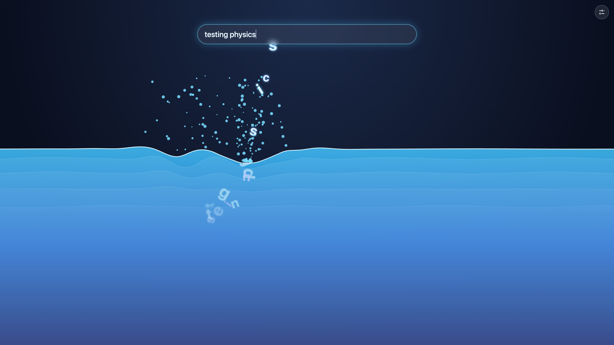

# Liquid



This project was generated using [Angular CLI](https://github.com/angular/angular-cli) version 22.2.3.

## Location and weather

The sun, moon and sunrise/sunset times come from the visitor's latitude and longitude. The page asks the browser for
the device location on load; if that is declined or blocked it falls back to an estimate from the time zone, and the
latitude and longitude can also be set by hand in the controls drawer. The location stays on the device (it is saved in
`localStorage` only).

The clouds follow the real weather where the visitor is: cloud cover at three heights and the wind come from
[Open-Meteo](https://open-meteo.com) (free, no account). This is the only thing the app sends anywhere: the
coordinates, rounded to 0.1° (about 11 km), are sent to `api.open-meteo.com`, and only when the location is real (the
device's, or typed in) and "Real clouds and wind for my location" is on. A time-zone guess is never sent. The answer is
kept for 20 minutes, and if the request fails the cloud sliders are used instead.

## Development server

To start a local development server, run:

```bash
ng serve
```

Once the server is running, open your browser and navigate to `http://localhost:4200/`. The application will automatically reload whenever you modify any of the source files.

## Code scaffolding

Angular CLI includes powerful code scaffolding tools. To generate a new component, run:

```bash
ng generate component component-name
```

For a complete list of available schematics (such as `components`, `directives`, or `pipes`), run:

```bash
ng generate --help
```

## Building

To build the project run:

```bash
ng build
```

This will compile your project and store the build artifacts in the `dist/` directory. By default, the production build optimizes your application for performance and speed.

## Running unit tests

To execute unit tests with the [Vitest](https://vitest.dev/) test runner, use the following command:

```bash
ng test
```

## Running end-to-end tests

For end-to-end (e2e) testing, run:

```bash
ng e2e
```

Angular CLI does not come with an end-to-end testing framework by default. You can choose one that suits your needs.

## Additional Resources

For more information on using the Angular CLI, including detailed command references, visit the [Angular CLI Overview and Command Reference](https://angular.dev/tools/cli) page.
